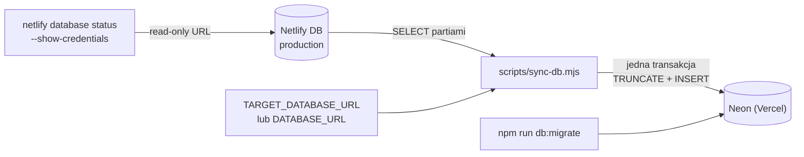

# Synchronizacja danych Netlify DB → Vercel (Neon)

Skrypt `scripts/sync-db.mjs` kopiuje **dane** z bazy Netlify do bazy Neon podpiętej do projektu Vercel
(`quiz-vercel`). Schematu nie tworzy — najpierw uruchom migracje na celu.



## Kiedy używać

- pierwsze wypełnienie bazy Neon danymi z produkcji Netlify,
- odtworzenie środowiska Vercel po awarii,
- okresowe kopiowanie danych przy równoległym działaniu obu hostingów.

To **jednorazowa kopia w jedną stronę**, nie replikacja: zmiany w Neon nie wracają do Netlify.

## Wymagania

- `netlify` CLI zalogowany do projektu (źródło jest czytane przez `netlify database status` i jest **read-only**),
- `DATABASE_URL` / `TARGET_DATABASE_URL` bazy Neon (np. z `vercel env pull`),
- migracje zaaplikowane na cel: `npm run db:migrate`,
- Node 22+ (globalny `fetch`/ESM) i zależność `pg` (już w `package.json`).

## Użycie

```bash
# podgląd bez zapisu
npm run db:sync -- --dry-run

# pełna synchronizacja (cel musi być pusty albo podaj --replace)
npm run db:sync -- --replace

# źródło z pliku env, cel wprost
npm run db:sync -- --from "$NETLIFY_DB_URL" --to "postgres://…" --replace

# tylko wybrane tabele
npm run db:sync -- --tables quizzes,questions,options --replace
```

## Runbook

### 1. Sprawdź stan obu baz

```bash
netlify database status --branch production                  # źródło + lista migracji
npm run db:sync -- --dry-run                                 # porównanie tabel i liczba wierszy
```

### 2. Przygotuj schemat celu (raz)

```bash
vercel env pull .env.local --environment production --yes    # DATABASE_URL
env -u DATABASE_URL node --env-file=.env.local scripts/migrate.mjs
```

### 3. Skopiuj dane

```bash
# cel pusty — bez --replace
env -u DATABASE_URL node --env-file=.env.local scripts/sync-db.mjs

# cel ma już dane (np. seed) — wyczyść i wgraj ponownie
env -u DATABASE_URL node --env-file=.env.local scripts/sync-db.mjs --replace
```

### 4. Zweryfikuj

```bash
npm run db:sync -- --dry-run       # liczby powinny się zgadzać
curl -s https://quiz-vercel-rho.vercel.app/api/health
```

Po synchronizacji zaloguj się na Vercel i sprawdź listę quizów oraz `/results` — dane są
przypisane do `user_id` z Auth0, które są takie same na obu hostingach.

## Co robi skrypt

1. Czyta listę tabel ze źródła i porównuje z celem (brak tabeli = błąd z podpowiedzią `npm run db:migrate`).
2. Ustala kolejność tabel na podstawie kluczy obcych (dzieci po rodzicach).
3. W jednej transakcji: `TRUNCATE … CASCADE` (przy `--replace`), `INSERT` partiami, `setval` sekwencji.
4. Weryfikuje liczbę wierszy każdej tabeli; przy różnicy robi `ROLLBACK`.
5. Kopiuje identyfikatory (UUID i `SERIAL`) bez zmian — powtórzenia i powiązania zostają spójne.
6. Kolumny `json`/`jsonb` wysyła jako tekst z rzutowaniem (`$n::jsonb`), bo `pg` zamieniłby tablicę JS
   na literał tablicy Postgresa i dostałby `invalid input syntax for type json`.

Pomijana jest tylko tabela `schema_migrations` (historia migracji celu).

### Kolejność tabel (FK)

```
cefr_levels, difficulty_levels, popularity_tiers, verb_patterns, subjects
  → irregular_verbs → verb_forms, verb_meanings
  → courses → lessons → lesson_verbs
  → quizzes → questions → options
  → quiz_attempts, verb_reviews, assignments, lesson_progress
classes → class_members
```

Kolejność jest wyliczana z `pg_constraint` w locie, więc nowe tabele i FK są obsługiwane
automatycznie. Cykl FK powoduje ostrzeżenie i kopiowanie alfabetyczne.

## Opcje

| Opcja | Znaczenie |
| --- | --- |
| `--from <url>` | connection string źródła; domyślnie Netlify CLI |
| `--to <url>` | cel; domyślnie `TARGET_DATABASE_URL` lub `DATABASE_URL` |
| `--branch <name>` | gałąź Netlify DB (domyślnie `production`) |
| `--tables a,b` | tylko wskazane tabele |
| `--exclude a,b` | pomiń wskazane tabele |
| `--replace` | wyczyść cel przed kopiowaniem (wymagane, gdy cel ma dane) |
| `--dry-run` | tylko raport liczby wierszy |
| `--batch <n>` | wierszy na `INSERT` (domyślnie 500) |

## Weryfikacja po synchronizacji

```sql
-- liczba wierszy w obu bazach powinna być identyczna
SELECT 'quizzes' AS t, count(*) FROM quizzes
UNION ALL SELECT 'questions', count(*) FROM questions
UNION ALL SELECT 'options', count(*) FROM options;

-- sekwencje nie mogą być za MAX(id)
SELECT last_value, (SELECT max(id) FROM irregular_verbs) AS max_id FROM irregular_verbs_id_seq;
```

Skrypt robi to samo automatycznie i przy najmniejszej różnicy wycofuje całą transakcję.

## Troubleshooting

| Objaw | Przyczyna | Rozwiązanie |
| --- | --- | --- |
| `password authentication failed` mimo poprawnego pliku env | w shellu jest **wyeksportowany** stary `DATABASE_URL`, a `--env-file` nie nadpisuje istniejących zmiennych | `env -u DATABASE_URL node --env-file=.env.local scripts/sync-db.mjs …` albo `--to <url>` |
| `Cannot read the Netlify database connection string` | brak `netlify login`, brak `netlify link`, albo CLI < 26 | `netlify link`, `netlify database status --branch production`, ewentualnie `--from` / `NETLIFY_DB_URL` |
| `tables missing in the target: …` | cel bez migracji lub migracje częściowe | `env -u DATABASE_URL node --env-file=.env.local scripts/migrate.mjs` |
| `column "x.y" is missing in the target` | schemat celu starszy niż źródła | nowa migracja + ponowny deploy (Vercel jej nie aplikuje sam) |
| `target already has rows in: …` | cel nie jest pusty | dodaj `--replace` (czyści `TRUNCATE … CASCADE`) |
| `row count mismatch` | błąd kopiowania lub współbieżny zapis | transakcja została wycofana; powtórz na spokojnej bazie |
| `invalid input syntax for type json` | stara wersja skryptu bez rzutowania `::jsonb` na kolumnach `answers`/`results` | zaktualizuj skrypt (obsługa `json`/`jsonb` jest wbudowana) |
| timeout / `connection terminated` | limit połączeń Neon (pooler) | `--batch 200`, ewentualnie użyj `DATABASE_URL_UNPOOLED` |
| zawieszone na `authorizing` | `netlify` CLI czeka na logowanie | uruchom `netlify login` w osobnym terminalu |

## Cykliczna synchronizacja (opcjonalnie)

Jednorazowy skrypt można wywołać z crona lub GitHub Actions. Przykład workflow
(kopia co dobę; wymaga sekretów `NETLIFY_AUTH_TOKEN`, `NETLIFY_SITE_ID`, `TARGET_DATABASE_URL`):

```yaml
name: db-sync
on:
  schedule: [{ cron: '0 3 * * *' }]
  workflow_dispatch:
jobs:
  sync:
    runs-on: ubuntu-latest
    steps:
      - uses: actions/checkout@v4
      - uses: actions/setup-node@v4
        with: { node-version: 22, cache: npm }
      - run: npm ci
      - run: npx netlify database status --branch production --json > netlify-db.json
        env: { NETLIFY_AUTH_TOKEN: '${{ secrets.NETLIFY_AUTH_TOKEN }}' }
      - run: node scripts/sync-db.mjs --from "$(jq -r .database.connectionString netlify-db.json)" --replace
        env: { TARGET_DATABASE_URL: '${{ secrets.TARGET_DATABASE_URL }}' }
```

W CI użyj `--from` (zamiast polegać na `netlify link`), bo katalog roboczy nie jest powiązany z site'em.

## Ograniczenia i bezpieczeństwo
- Kopiowane są wyłącznie tabele z `public`; brak ról, uprawnień, rozszerzeń, sekwencji innych niż `nextval`.
- Źródło jest czytane **bez snapshotu** — przy równoległych zapisach wynik może być chwilowo niespójny.
  Przy produkcji z aktywnym ruchem użyj `--tables` dla stabilnych zbiorów albo powtórz synchronizację.
- `--replace` wykonuje `TRUNCATE … CASCADE` na wszystkich wybranych tabelach — to operacja nieodwracalna
  dla danych celu. Zawsze najpierw `--dry-run`.
- Connection stringi nie są logowane; w konsoli widać tylko hosty. Nie wklejaj URL-i do zgłoszeń.
- Konto źródłowe z `netlify database status` to `netlifydb_readonly` — zapis do źródła jest niemożliwy.
