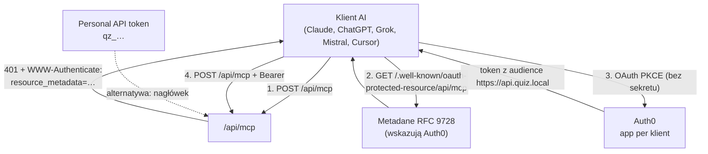

---
tags:
  - docs
  - mcp
  - deploy
created: 2026-10-19
updated: 2026-10-20
---

# Rejestracja serwera MCP u klientów AI (Claude, ChatGPT, OpenAI, Grok, Mistral)

Serwer MCP quizu działa pod `POST /api/mcp` i obsługuje **dwie niezależne metody** dostępu.
Instrukcje dla aplikacji: [mcp.md](mcp.md) · szczegóły Grok: [mcp-grok.md](mcp-grok.md).



## Która metoda dla którego klienta

| Metoda | Kiedy | Czego używa | Tożsamość |
| --- | --- | --- | --- |
| **Token API `qz_…`** | klienci z polem „nagłówki” / CLI / skrypty / Responses API | wartość z Ustawienia → Tokeny API | właściciel tokenu, z migawką uprawnień z chwili utworzenia |
| **Konektor OAuth** | claude.ai, ChatGPT, Le Chat, Grok — logowanie przyciskiem | osobna aplikacja Auth0 na klienta (PKCE, bez sekretu) | zalogowany użytkownik i jego aktualna rola |

Konektor OAuth jest wygodniejszy (logujesz się jak w aplikacji), ale wymaga jednorazowego
założenia aplikacji Auth0. Token `qz_…` działa natychmiast i nadaje się do automatyzacji.

## Wartości wspólne

| Pole | Wartość |
| --- | --- |
| Adres serwera MCP (produkcja) | `https://quiz-vercel-rho.vercel.app/api/mcp` |
| Adres serwera MCP (Vercel) | `https://quiz-vercel-rho.vercel.app/api/mcp` |
| Metadane zasobu (RFC 9728) | `<adres MCP bez /api/mcp>/.well-known/oauth-protected-resource/api/mcp` |
| Punkt końcowy autoryzacji | `https://dev-4xxb1z18b3z4hc6s.us.auth0.com/authorize` |
| Punkt końcowy tokenu | `https://dev-4xxb1z18b3z4hc6s.us.auth0.com/oauth/token` |
| Zakresy | `openid profile email` (+ `offline_access` — dozwolone w API dla tokenu odświeżania; metadane ogłaszają trzy pierwsze) |
| Metoda uwierzytelniania tokena | `none` (klient publiczny, tylko PKCE, **bez sekretu**) |
| Audience | `https://api.quiz.local` (ustawiony jako `default_audience` tenanta) |

Narzędzia (51): `quiz_list`, `quiz_get`, `quiz_schema`, `quiz_create`, `quiz_update`,
`quiz_delete`, `verbs_list`, `class_list`, `class_get`, `class_create`, `class_update`,
`class_regenerate_code`, `class_archive`, `class_report`, `class_analyze`, `student_list`,
`student_search`, `student_add`, `student_remove`, `student_results`, `student_analyze`,
`course_list`, `assignment_create`, `assignment_update_due`, `assignment_delete`,
`attempt_list`, `attempt_get`, `quiz_stats`, `user_results`, `user_analysis`, `user_list`,
`user_get`, `user_search`, `user_roles_set`, `user_block`, `class_transfer`, `audit_list`,
`feedback_list`, `feedback_update`, `settings_get`, `settings_set`, `system_stats`, `media_upload`,
`media_upload_from_url`, `media_create_upload`, `media_complete`, `media_list`, `media_get`, `media_delete`,
`lesson_get`, `lesson_update`.
Wszystkie narzędzia `media_*` oraz `lesson_*` wymagają `write:quizzes`; `media_upload_from_url` działa tylko przy `MEDIA_URL_FETCH=true` (domyślnie wyłączone, zob. [mcp.md](mcp.md#obrazy-ścieżki-wysyłania-i-zabezpieczenia)).
Zapis quizów wymaga roli **admin**, klasy i wyniki — roli **nauczyciel** (`teacher`).
Narzędzia administracyjne (wszystko od `attempt_*` do `system_stats`) wymagają `manage:users`, czyli
**tylko konektora OAuth** (token `qz_…` tego uprawnienia nie dostaje): administrator je wywoła,
nauczyciel i uczeń nie. Szczegóły i zabezpieczenia: [mcp.md](mcp.md#narzędzia).
Opis narzędzi do wklejenia w claude.ai: [[Claude-Web]].

### Aplikacje Auth0 dla konektorów

| Klient | Aplikacja Auth0 | Client ID | Adres zwrotny |
| --- | --- | --- | --- |
| Claude (claude.ai) | Quiz MCP (Claude) | `bH1zf4YpkRYRo4x9gQJdFo4CRrNEPvyq` | `https://claude.ai/api/mcp/auth_callback`, `https://claude.com/api/mcp/auth_callback` |
| ChatGPT | Quiz MCP (ChatGPT) | `sJXSXHmpybLDu3XKi1SsammcaD4FHuhs` | `https://chatgpt.com/connector/oauth/KyVUTbJemWMq`, `https://chatgpt.com/connector/oauth/t4V0BDhxcgpm` |
| Mistral (Le Chat) | Quiz MCP (Mistral) | `KXAj39YXvdtlFGS7pIyVePWq2HWykGp4` | `https://callback.mistral.ai/v1/integrations_auth/oauth2_callback` |
| Grok | Quiz MCP (Grok) | `uqhQ3SV4BdKL1cUvyZC735N4ZdaGw6el` | `https://grok.com/connectors-oauth-exchange-code/` |

> Nie wpisuj nigdzie danych aplikacji „Quiz Management” (`AUTH0_MGMT_CLIENT_ID/SECRET`) —
> to sekret administracyjny wyłącznie dla serwera.

---

## 1. Claude (claude.ai) — konektor OAuth

Gotowe opisy do wklejenia (formularz, „description”, instrukcje projektu): [[Claude-Web]].

1. **Settings → Connectors → Add custom connector**.
2. Wpisz:
   - Name: `Quiz`,
   - Remote MCP server URL: `https://quiz-vercel-rho.vercel.app/api/mcp`,
   - Client ID: `bH1zf4YpkRYRo4x9gQJdFo4CRrNEPvyq`,
   - Client Secret: **puste** (klient publiczny),
   - jeśli formularz pyta o adresy: Authorization URL i Token URL z tabeli powyżej.
3. **Connect** → logujesz się na konto, którego używasz w quizie (Google = admin,
   Discord = uczeń, nauczyciel = konto z rolą `teacher`).
4. Po powrocie włącz konektor w rozmowie (ikona narzędzi → Quiz) i sprawdź listę narzędzi.

Narzędzia zapisujące poproszą o zatwierdzenie — zezwól świadomie, każda zmiana trafia do audytu.

## 2. Claude Code — token API

```bash
claude mcp add --transport http quiz \
  https://quiz-vercel-rho.vercel.app/api/mcp \
  --header "Authorization: Bearer qz_…"
claude mcp list
```

Zmienna zamiast literału (bezpieczniej w powłoce):

```bash
export QUIZ_TOKEN=qz_…
claude mcp add --transport http quiz https://quiz-vercel-rho.vercel.app/api/mcp \
  --header "Authorization: Bearer $QUIZ_TOKEN"
```

## 3. Claude Desktop — most stdio

Claude Desktop nie obsługuje zdalnych serwerów HTTP, więc pośredniczy `mcp-remote`:

```json
{
  "mcpServers": {
    "quiz": {
      "command": "npx",
      "args": [
        "-y",
        "mcp-remote",
        "https://quiz-vercel-rho.vercel.app/api/mcp",
        "--header",
        "Authorization:Bearer ${QUIZ_TOKEN}"
      ],
      "env": { "QUIZ_TOKEN": "qz_…" }
    }
  }
}
```

Plik: `~/Library/Application Support/Claude/claude_desktop_config.json` (macOS) lub
`%APPDATA%\Claude\claude_desktop_config.json` (Windows). Po zapisie zrestartuj aplikację.

## 4. ChatGPT — konektor OAuth

1. **Settings → Connectors → Advanced → Developer mode** (konto z dostępem do konektorów).
2. **Create** / **Add custom connector**.
3. Wpisz:
   - Name: `Quiz`,
   - MCP Server URL: `https://quiz-vercel-rho.vercel.app/api/mcp`,
   - Authentication: **OAuth**,
   - Client ID: `sJXSXHmpybLDu3XKi1SsammcaD4FHuhs`,
   - Client Secret: **puste**.
4. Zapisz, zaloguj się przez Auth0 i w rozmowie włącz konektor w menu narzędzi.

> Adres zwrotny ChatGPT zawiera unikalny identyfikator konektora (`…/connector/oauth/KyVUTbJemWMq`).
> Po usunięciu i ponownym utworzeniu konektora **zmieni się**, a logowanie skończy się błędem
> `unauthorized_client: Callback URL mismatch` — wtedy dopisz nowy adres do aplikacji Auth0,
> zachowując stary. Oba naraz są w porządku: nieużywany wpis nie przeszkadza, a po jego
> usunięciu stary konektor przestałby działać:
>
> ```bash
> auth0 api patch "clients/sJXSXHmpybLDu3XKi1SsammcaD4FHuhs" --json --data '{
>   "callbacks": [
>     "https://chatgpt.com/connector/oauth/<nowy>",
>     "https://chatgpt.com/connector/oauth/<stary>"
>   ]
> }'
> ```
>
> Właściwy adres znajdziesz też w logu: `auth0 logs list --filter "type:f" --json` (pole
> `details.error.payload.attempt`).

## 5. OpenAI — Responses API (programowo)

```bash
curl https://api.openai.com/v1/responses \
  -H "Authorization: Bearer $OPENAI_API_KEY" \
  -H "Content-Type: application/json" \
  -d '{
    "model": "<model>",
    "input": "Wypisz moje quizy",
    "tools": [{
      "type": "mcp",
      "server_label": "quiz",
      "server_url": "https://quiz-vercel-rho.vercel.app/api/mcp",
      "headers": { "Authorization": "Bearer '"$QUIZ_TOKEN"'" },
      "require_approval": "always"
    }]
  }'
```

`require_approval: "always"` zostaw dla operacji zapisujących — model zapyta przed wywołaniem.
Dla odczytu można ustawić `"never"`.

## 6. Grok (xAI)

Grok ma dwa tryby; szczegółowy opis: [mcp-grok.md](mcp-grok.md).

**Konektor (OAuth)** — „Kolektor niestandardowy”:

| Pole | Wartość |
| --- | --- |
| Adres serwera MCP | `https://quiz-vercel-rho.vercel.app/api/mcp` |
| Identyfikator klienta | `uqhQ3SV4BdKL1cUvyZC735N4ZdaGw6el` |
| Klucz tajny klienta | **puste** |
| Punkt końcowy autoryzacji | `https://dev-4xxb1z18b3z4hc6s.us.auth0.com/authorize` |
| Punkt końcowy tokenu | `https://dev-4xxb1z18b3z4hc6s.us.auth0.com/oauth/token` |
| Zakresy | `openid` |
| Metoda uwierzytelniania tokena | `none (tylko PKCE, zalecane)` |

**Responses API (xAI)** — jak w OpenAI, z `server_url` i nagłówkiem `Bearer qz_…`.

## 7. Mistral (Le Chat)

1. **Connectors → Add connector → Custom MCP**.
2. Server URL: `https://quiz-vercel-rho.vercel.app/api/mcp`,
   Client ID: `KXAj39YXvdtlFGS7pIyVePWq2HWykGp4`, sekret pusty.
3. Zaloguj się i włącz konektor w rozmowie.

## 8. Cursor, VS Code i inni klienci MCP

Plik konfiguracyjny w formacie `mcpServers` (Cursor: `.cursor/mcp.json`,
VS Code: `.vscode/mcp.json`, inne klienty: własna ścieżka):

```json
{
  "mcpServers": {
    "quiz": {
      "type": "http",
      "url": "https://quiz-vercel-rho.vercel.app/api/mcp",
      "headers": { "Authorization": "Bearer qz_…" }
    }
  }
}
```

Klienty obsługujące OAuth same przejdą discovery z `WWW-Authenticate` — wystarczy adres
serwera, ale i tak potrzebują **własnej aplikacji Auth0** z ich adresem zwrotnym
(dynamiczna rejestracja klientów w tym tenancie jest wyłączona).

---

## Dodanie nowego klienta (nowa aplikacja Auth0)

1. **Zdobądź adres zwrotny.** Z dokumentacji klienta albo z formularza konektora.
   Jeśli go nie znasz: wykonaj próbę logowania z dowolnym Client ID — Auth0 zgłosi
   „Callback URL mismatch”, a właściwy adres odczytasz z logów:

   ```bash
   auth0 logs list --filter "type:f" --json        # pole details.qs.redirect_uri
   ```

2. **Utwórz aplikację** (SPA, PKCE, bez sekretu), osobną dla każdego klienta:

   ```bash
   auth0 apps create --name "Quiz MCP (<klient>)" --type spa \
     --callbacks "<adres zwrotny>" \
     --origins "https://<domena klienta>" --web-origins "https://<domena klienta>" \
     --description "<klient> connector for the quiz MCP server (PKCE, no secret)" \
     --no-input --json
   auth0 apps update <client_id> --grants code,refresh-token   # bez implicit
   ```

   Z odpowiedzi zapisz `client_id`. `token_endpoint_auth_method` ma być `none`.

3. **Wpisz w konektorze** adres serwera MCP, Client ID z kroku 2, puste pole sekretu
   oraz (jeśli formularz tego wymaga) Authorization/Token URL z tabeli „Wartości wspólne”.

4. **Dopisz klienta do tabeli** w tym dokumencie i w [mcp.md](mcp.md).

5. **Sprawdź discovery:**

   ```bash
   curl -s https://quiz-vercel-rho.vercel.app/.well-known/oauth-protected-resource/api/mcp | jq
   ```

W tenancie są już ustawione (nie zmieniaj): `default_audience` = `https://api.quiz.local`
oraz `allow_offline_access` w API.

## Odbieranie dostępu

| Zakres | Jak |
| --- | --- |
| jeden klient | usuń jego konektor w aplikacji **i** aplikację Auth0: `auth0 apps delete <client_id>` |
| jeden użytkownik | odbierz rolę w Ustawienia → Użytkownicy (działa po ponownym zalogowaniu) |
| token `qz_…` | Ustawienia → Tokeny API → unieważnij (natychmiast) |
| cały serwer MCP | zostaw tylko tokeny; konektory przestaną dostawać tokeny po usunięciu aplikacji Auth0 |

## Po zmianie narzędzi lub schematu

Serwer jest bezsesyjny i odpowiada czystym JSON-em, więc **nie wysyła** `notifications/tools/list_changed`. Klient pobiera listę narzędzi (nazwy, opisy, `inputSchema`) przy dodaniu konektora lub starcie rozmowy i zwykle ją buforuje.

| Co się zmieniło | Kiedy model to zobaczy |
| --- | --- |
| wynik `quiz_schema` (reguły i limity pól, nowe typy pytań) | od razu, przy następnym wywołaniu `quiz_schema` |
| opisy narzędzi, `inputSchema`, nowe lub usunięte narzędzia | dopiero po odświeżeniu konektora w kliencie i w **nowej** rozmowie (trwająca zwykle zachowuje starą listę) |

Zasady po naszej stronie: opisy `quiz_create` i `quiz_update` kierują do `quiz_schema` jako źródła prawdy i nie powtarzają limitów liczbowych; przy zmianie kontraktu narzędzi podbijamy `version` w `server/mcp/index.ts`. Po wdrożeniu zmiany w narzędziach: odśwież konektor (ChatGPT, Claude) albo usuń go i dodaj ponownie, potem zacznij nową rozmowę. **Przypomnienie przy każdym wydaniu z nowymi narzędziami** (np. 2.3.0 z 51 narzędziami, w tym siedmioma `media_*` i dwoma `lesson_*`): bez odświeżenia konektora klient nie zobaczy nowych narzędzi, a zobaczy tylko te, które miał wcześniej. Weryfikacja bez klienta: `tools/list` z sekcji poniżej pokazuje to, co serwer zwraca teraz.

## Rozwiązywanie problemów

| Objaw | Przyczyna i działanie |
| --- | --- |
| „Callback URL mismatch” | dwie przyczyny. (1) W formularzu jest Client ID innej aplikacji — porównaj `client_name` w logu z tabelą aplikacji. (2) Konektor został usunięty i utworzony ponownie: ChatGPT generuje nowy adres `…/connector/oauth/<id>` przy **każdym nowym** konektorze. Dopisz go, zachowując poprzedni: `auth0 api patch "clients/<client_id>" --json --data '{"callbacks":["<nowy>","<stary>"]}'` (lista nadpisuje się w całości, więc podaj wszystkie) |
| konektor połączony, lista narzędzi pusta, „auth: unavailable” | token bez `audience` — sprawdź `auth0 logs list --filter "type:seacft"` (ma być `https://api.quiz.local`) i `default_audience` tenanta; potem **usuń i dodaj konektor ponownie** (stary token zostaje) |
| klient pyta o `/authorize` albo `/register` na naszej domenie | discovery nie działa — `curl <serwer>/.well-known/oauth-protected-resource/api/mcp` ma zwrócić JSON, nie stronę aplikacji |
| narzędzia są, ale zapis/klasy zwracają odmowę | rola użytkownika: zapis quizów = admin, klasy i wyniki = nauczyciel; role zmienia admin w Ustawieniach, działają po ponownym zalogowaniu |
| błąd CORS / origin | dopisz domenę klienta do `--origins` i `--web-origins` aplikacji Auth0 |
| 401 mimo poprawnych nagłówków | token `qz_…` unieważniony lub wygasły, albo brak wymaganego uprawnienia w migawce tokenu |
| 415 „Content-Type must be application/json” | klient użył transportu z niepoprawnym nagłówkiem — serwer jest bezsesyjny i przyjmuje tylko `POST` z JSON-em |
| 405 | `GET`/`DELETE /api/mcp` są wyłączone (brak sesji) |

## Weryfikacja bez klienta AI

```bash
# lista narzędzi
curl -s -X POST https://quiz-vercel-rho.vercel.app/api/mcp \
  -H "Authorization: Bearer $QUIZ_TOKEN" -H "Content-Type: application/json" \
  -d '{"jsonrpc":"2.0","id":1,"method":"tools/list"}' | jq '.result.tools[].name'

# metadane OAuth
curl -s https://quiz-vercel-rho.vercel.app/.well-known/oauth-protected-resource/api/mcp | jq

# lokalnie, bez Auth0 (tylko npm run dev:full)
npm run test:mcp
```
